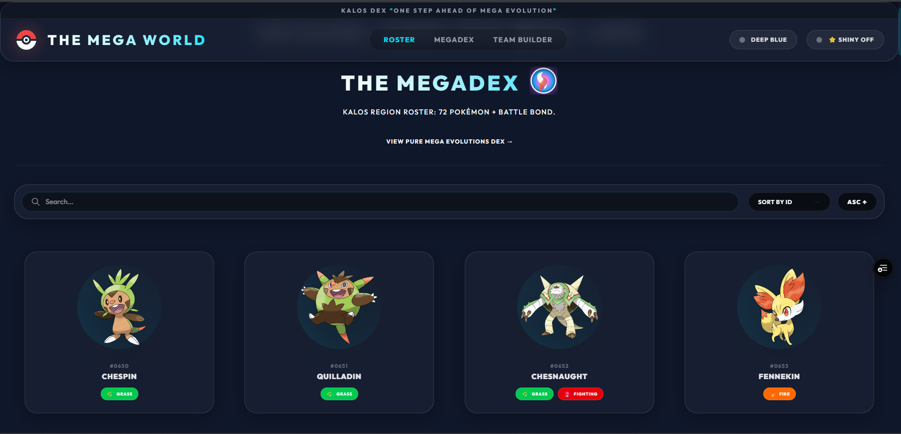
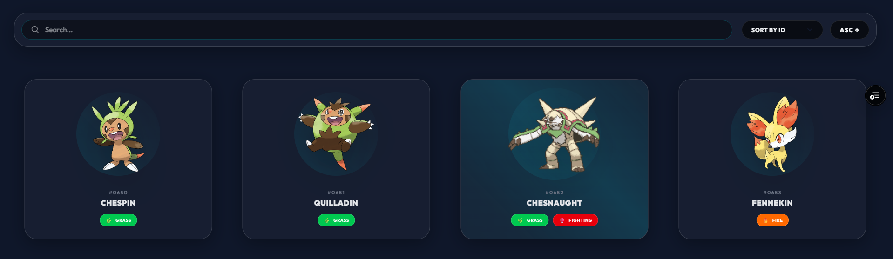
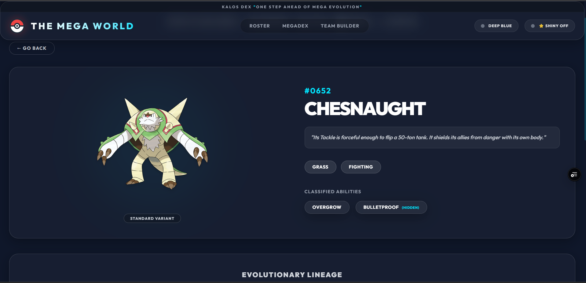
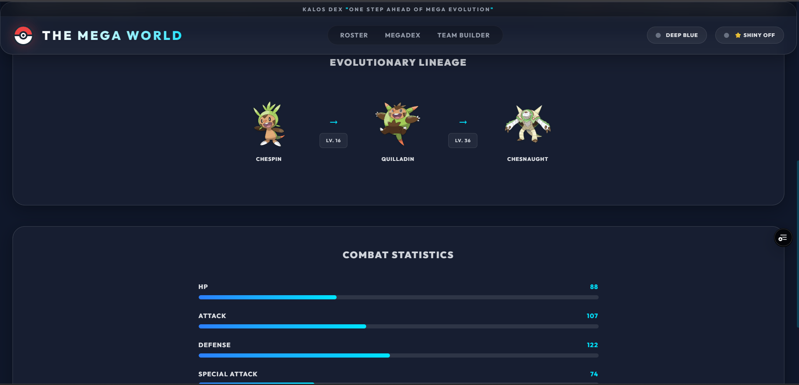

# 🌐 Kalos-Dex • 9th-Gen Holographic Pokédex

[](https://react.dev/)
[](https://vitejs.dev/)
[](https://threejs.org/)
[](https://r3f.docs.pmnd.rs/)
[](https://tailwindcss.com/)
[](https://www.framer.com/motion/)
[](https://supabase.com/)

An advanced, futuristic 9th-Generation Pokédex web application dedicated to the Kalos region. Built with **React 19**, **Three.js / React Three Fiber**, **Framer Motion**, and **Tailwind CSS v4**, the application delivers a guest-first holographic terminal experience featuring an interactive 3D geospatial map, tactile anti-gravity cards with dynamic light glare, tactical team building with 18-type defensive coverage analytics, and a soft-grey light mode.

---

## 📸 Interface Preview

| Holographic Pokédex Roster | Interactive 3D Kalos Topology Map |
| :---: | :---: |
|  |  |

| Combat Specimen Telemetry | Evolutionary Lineage Flowchart |
| :---: | :---: |
|  |  |

---

## 🚀 Key Features

### 1. 🗺️ Interactive 3D Kalos Region Map (`Three.js` & `@react-three/fiber`)
* **3D Cartographic Topology**: Procedural low-poly continental landmass modeled after Kalos's iconic five-pointed star geography, featuring coastal shelves, eastern alpine peaks, and central plateaus.
* **Holographic City Beacons**: Interactive, glowing 3D beacons for major Kalos cities (Lumiose City, Shalour City, Laverre City, Snowbelle City, Geosenge Town, and more).
* **3D Landmark Spires**: Detailed spires for Lumiose's Prism Tower (with an animated sky beam), Anistar's Cosmic Sundial, and Shalour's Tower of Mastery.
* **Animated Route Splines**: Holographic route vectors (`Line` from `@react-three/drei`) visualizing Kalos's transportation network.
* **Regional Telemetry Inspector**: Click any beacon to reveal regional lore, gym leader data, gym badges, signature specimens, and highway networks.
* **Strict Orbit Limits**: High-precision `OrbitControls` with strict damping, zoom limits (`minDistance: 5.5`, `maxDistance: 20`), and restricted azimuth/polar angles to prevent disorienting perspective loss.

### 2. 🎴 3D Anti-Gravity Tilt Cards (`Framer Motion`)
* **Tactile Cursor Tracking**: Smooth mathematical 3D perspective transforms (`perspective: 1000px`, `rotateX`, `rotateY`) reacting dynamically to pointer movement.
* **Dynamic Holographic Glare**: Multi-gradient reflection sheen that follows the lighting angle across the card surface in real-time.
* **Z-Space Depth Layering**: Artwork elevates forward in 3D space (`translateZ: 45px`), ambient glows float behind, and metadata tags hover with natural parallax.
* **Audio Telemetry**: PokeAPI cry audio plays at a comfortable volume on card hover.

### 3. 🛡️ Tactical Team Builder & 18-Type Coverage Matrix
* **6-Member Battle Squad**: Click-to-add interface drawing from both the Kalos regional roster and Mega Evolution forms.
* **Complete 18-Type Defense Matrix**: Dynamic calculation of team vulnerabilities (`>1x`), resistances (`<1x`), and immunities (`0x`) for every single elemental type.
* **Squad Stat Analytics**: Aggregated Base Stat Total (BST) and comparative averages across HP, Attack, Defense, Sp. Atk, Sp. Def, and Speed.
* **Cloud & Local Persistence**: Squads persist in `localStorage` for guests, with single-click Supabase cloud synchronization for authenticated trainers.

### 4. ⚔️ Side-by-Side Specimen Comparison Tool
* **Direct Stat Matrix**: Comparative side-by-side bar charts displaying stat deltas and visually illuminating the superior combatant.
* **Defensive Matchup Analysis**: Color-coded breakdown of damage multipliers taken from incoming attacks of all 18 elemental types.
* **Physical & Ability Breakdown**: Direct inspection of heights, weights, base experience, and ability classifications.

### 5. 🔬 Comprehensive PokeAPI Integration
* **Animated Combat Stats**: Base stat distribution with animated progress bars.
* **Classified Abilities**: Standard and Hidden abilities with contextual tactical descriptions.
* **Evolutionary Lineage Flowchart**: Interactive visual progression showing levels, items, happiness, time of day, and special conditions (including the Ash-Greninja Battle Bond branch).
* **Segmented Movepool**: Complete move library filtered by learn methods (Level-Up, TM/HM, Egg Moves, and Tutor Moves).
* **Biological Telemetry**: Gender distribution ratios, egg groups, hatch cycles, and Effort Value (EV) yields.

### 6. 🎨 3-Way Dynamic Themes & "Soft Grey" Light Mode
* **Soft Grey & Silver Daylight Mode**: High-contrast, glare-free aesthetic (`#E2E8F0` slate background with polished silver glass panels and deep slate navy typography) eliminating harsh white eye strain.
* **Deep Kalos Blue**: The signature holographic 9th-Gen theme with cyan neon accents.
* **Pitch Black**: True AMOLED `#030712` mode for maximum contrast and battery efficiency on OLED displays.
* **Global Shiny Sprite Toggle**: Instant toggle across the entire application switching all artwork and sprites to their official shiny variants.

### 7. 👤 Guest-First Authentication Architecture
* **Zero Barrier Access**: Immediate access to the Pokédex, 3D map, team builder, and comparison tools upon launch without forced authentication.
* **Holo-Caster Login Terminal**: Sleek modal dialog for optional Supabase authentication to backup teams and synchronize cross-device preferences.

---

## ⚡ Performance & WebGL Optimization

To guarantee consistent 60 FPS performance across desktop and mobile devices despite heavy 3D rendering and motion animations:

1. **Lazy Loading & Code Splitting**: The Three.js WebGL canvas (`KalosScene`) is dynamically imported via `React.lazy` and `Suspense`, preventing Three.js and Drei from inflating the initial bundle.
2. **GPU Pixel Ratio Clamping**: Canvas pixel ratio is clamped via `dpr={[1, 1.5]}` to prevent performance degradation on high-DPI (Retina/4K) mobile screens.
3. **Low-Poly Procedural Geometries**: The Kalos terrain mesh is built using a procedural 32x32 plane with vertex displacement instead of multi-megabyte heavy asset downloads.
4. **React Component Memoization**: Core grid items (`PokemonCard`) and calculation engines are wrapped with `React.memo`, `useMemo`, and `useCallback` to prevent cascading re-renders during 3D scene interactions or list sorting.

---

## 🛠️ Technology Stack

| Domain | Technology | Purpose |
| :--- | :--- | :--- |
| **Frontend Framework** | `React 19.2` + `Vite 8.1` | Ultra-fast HMR and modern concurrent React architecture |
| **3D & WebGL Engine** | `Three.js` + `@react-three/fiber` + `@react-three/drei` | Interactive 3D Kalos topological map & camera controls |
| **Animation Physics** | `Framer Motion 12.4` | 3D card tilt physics, page transitions, and stagger effects |
| **Styling & Tokens** | `Tailwind CSS v4.3` + CSS Custom Properties | Dynamic glassmorphism and non-hardcoded 3-way themes |
| **Data Engine** | `PokeAPI` + `Axios` | Live Pokémon database, cries, moves, and evolution chains |
| **Authentication** | `@supabase/supabase-js` | Guest-first session management and cloud team persistence |
| **Iconography** | `Lucide React` | High-tech HUD iconography and UI indicators |

---

## 💻 Installation & Local Development

### Prerequisites
* **Node.js** `>= 18.0.0`
* **npm** or **pnpm** / **yarn**

### 1. Clone the Repository
```bash
git clone https://github.com/kanishk3114S/KalosPokeDex.git
cd KalosPokeDex/frontend
```

### 2. Install Dependencies
```bash
npm install
```

### 3. Configure Supabase (Optional for Cloud Saves)
Create a `.env` file in the `frontend/` directory (refer to `ENV_EXAMPLE.TXT`):
```env
VITE_SUPABASE_URL="https://your-project.supabase.co"
VITE_SUPABASE_ANON_KEY="your-anon-key"
```
*(Note: If omitted, the application operates normally in Guest Mode with local storage).*

### 4. Run the Development Server
```bash
npm run dev
```
Open [http://localhost:5173](http://localhost:5173) in your browser.

### 5. Build for Production
```bash
npm run build
```
Compiled production assets will be generated in `frontend/dist/`.

---

## 📁 Project Architecture

```
frontend/
├── public/
│   ├── favicon.svg              # 9th-Gen Kalos Pokeball & Mega Core vector icon
│   └── ...
├── src/
│   ├── components/
│   │   ├── map/
│   │   │   ├── KalosScene.jsx   # Three.js Canvas with OrbitControls & lighting rig
│   │   │   ├── KalosTerrain.jsx # Low-poly procedural Kalos terrain & landmark spires
│   │   │   ├── CityMarker.jsx   # Interactive 3D beacon with holographic pulse & label
│   │   │   └── RouteLines.jsx   # Glowing holographic highway splines
│   │   ├── AuthModal.jsx        # Supabase trainer authentication terminal
│   │   ├── Navbar.jsx           # Telemetry header, theme toggler, and navigation deck
│   │   ├── PokemonCard.jsx      # Tactile 3D anti-gravity card (React.memo optimized)
│   │   └── Credits.jsx          # Creator credits banner
│   ├── constants/
│   │   ├── animations.js        # Centralized Framer Motion variants & spring physics
│   │   ├── kalosData.js         # Type configurations, elemental colors & Ash squad data
│   │   ├── kalosMapData.js      # Geospatial 3D coordinates, landmarks & gym telemetry
│   │   └── typeMatchups.js      # Complete 18-type effectiveness & coverage calculator
│   ├── context/
│   │   ├── AuthContext.jsx      # Guest-first authentication context
│   │   ├── FavoritesContext.jsx # Favorites state management
│   │   └── ThemeContext.jsx     # Deep Blue / Pitch Black / Soft-Grey mode controller
│   ├── hooks/
│   │   └── use3DCardTilt.js     # 3D perspective tilt and dynamic glare hook
│   ├── pages/
│   │   ├── Dashboard.jsx        # Main Pokédex roster with live filter deck
│   │   ├── KalosMap.jsx         # 3D Map viewport with landmark inspector drawer
│   │   ├── PokemonDetail.jsx    # Complete PokeAPI specimen intelligence dossier
│   │   ├── PokemonCompare.jsx   # Direct head-to-head combatant comparison tool
│   │   ├── TeamBuilder.jsx      # 6-slot squad builder with type coverage analytics
│   │   ├── MegaDex.jsx          # Mega Evolution catalog
│   │   └── Login.jsx            # Standalone login fallback
│   ├── App.jsx                  # Main router with lazy routes & AnimatePresence
│   ├── index.css                # Kalos design tokens, CSS variables & glassmorphism
│   └── main.jsx                 # Application entry point
```

---

## 🤝 Contributing

Contributions, feedback, and feature requests are welcome!
1. Fork the repository
2. Create a feature branch (`git checkout -b feature/amazing-feature`)
3. Commit your changes (`git commit -m 'feat: Add amazing feature'`)
4. Push to the branch (`git push origin feature/amazing-feature`)
5. Open a Pull Request

---

## 📜 License

Distributed under the **MIT License**. See `LICENSE` for more information.

---

**Designed & Developed with ❤️ by** **[Kanishk3114S](https://github.com/kanishk3114S)**  
[GitHub](https://github.com/kanishk3114S) • [LinkedIn](https://www.linkedin.com/in/kanishk-sharma-b0912735a/) • [LeetCode](https://leetcode.com/u/KanishkSharma3114/) • [Instagram](https://www.instagram.com/kanishk_x_sharma/?hl=en)
